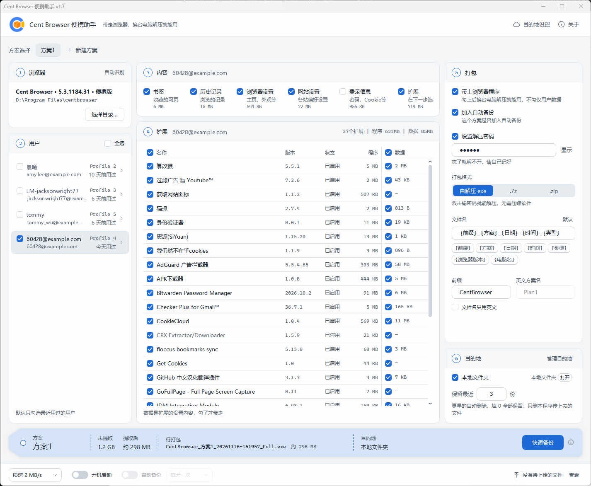

# Cent Browser 便携助手

> 一句话：带走浏览器，换台电脑解压就能用

把 Cent Browser 浏览器中用户的书签、历史、设置和扩展，可自定义内容，打成带密码的压缩包或自解压 exe，送到 SMB、WebDAV、FTP 或本地文件夹。换一台电脑下载下来，输入密码解压，就能直接用。

密码、Cookie、缓存和自动填充不会带走。打开「开机启动」与「自动备份」，浏览器空闲时就默默在后台为你准备，按设定的频率进行，勾选的用户数据没变化就跳过。

也能当瘦身、提取工具用：缓存这些累赘都留在原地，包一下子就轻了 ～(´▽｀)

## 运行要求

- Windows 10 / 11 x64
- 不带运行时的包需要 [.NET 8 桌面运行时](https://dotnet.microsoft.com/download/dotnet/8.0)。自带运行时的包不用另装

## 下载

- [不带运行时](https://github.com/luowenfu/CentBrowser-PortableAssistant/releases/download/v1.2/CentBrowser-PortableAssistant-v1.2.exe)（3.9 MB，需要 .NET 8 桌面运行时）
- [自带运行时](https://github.com/luowenfu/CentBrowser-PortableAssistant/releases/download/v1.2/CentBrowser-PortableAssistant-v1.2-selfcontained.exe)（70.1 MB，不用另装运行时）

## 使用

主界面分三栏六步，一屏看完，改动自动保存。左栏是第 1、2 步，中栏上面第 3 步、下面第 4 步，右栏是第 5、6 步：



1. **浏览器**：自动识别 Cent Browser，也可以手动选 chrome.exe 所在目录。每个方案单独选
2. **用户**：新方案默认只勾选最近用过的用户。点用户名切换过去，行上有昵称、邮箱和最近使用时间
3. **内容**：这个用户的书签、历史记录、浏览器设置、扩展
4. **扩展**：可按版本、状态和大小单独挑。勾上扩展时数据也会勾上，可以再取消。扩展没勾时，数据也不能勾
5. **打包**：是否带上浏览器程序、解压密码、打包格式、文件名
6. **目的地**：送到哪些目的地、保留几份

### 关于备份

底栏两个开关。关掉开机启动时，自动备份一起关掉，并且不能点。

- **开机启动**：常驻托盘
- **自动备份**：关掉浏览器 2 分钟后慢速备份。这 2 分钟里又打开就取消。勾选的内容没变化就跳过

频率可以选每天、每周或每月。

- **快速备份**：全速打包，上传不限速。

- **慢速备份**：打包降优先级，上传按限速设置，默认 1 MB/s，只限「远程目的地」类型。
- **托盘菜单**：进行的手动备份可以选快速或慢速。

### 其他

「关于」页里，重置和卸载是两项：

- **重置**：删掉设置、备份记录和还没传完的文件，回到刚开始用的状态
- **卸载**：再删掉本机上释放的工具文件并退出。之后删掉本程序就行
- **新版本**：有新版本时出现在「关于」右边，点开可以查看说明并更新

目的地里已有的备份，两种都不会删。

### 注意

- 备份时需关闭浏览器。提取途中又打开浏览器会停下，等下次关闭再试。打包时可以照常用浏览器
- 换电脑后，少数设置或扩展可能被浏览器重置

## 构建

```powershell
.\build.ps1                 # 测试版，不带运行时
.\build.ps1 -Bump Release   # 正式版，同时出不带运行时和自带运行时两个包
```

版本号由 `build.ps1` 维护在根目录的 `VERSION` 文件里，不要手动改。

## 第三方组件

- [7-Zip](https://www.7-zip.org/) 25.01，GNU LGPL，见 `third_party/7zip/License.txt`
- [FluentFTP](https://github.com/robinrodricks/FluentFTP)，MIT
